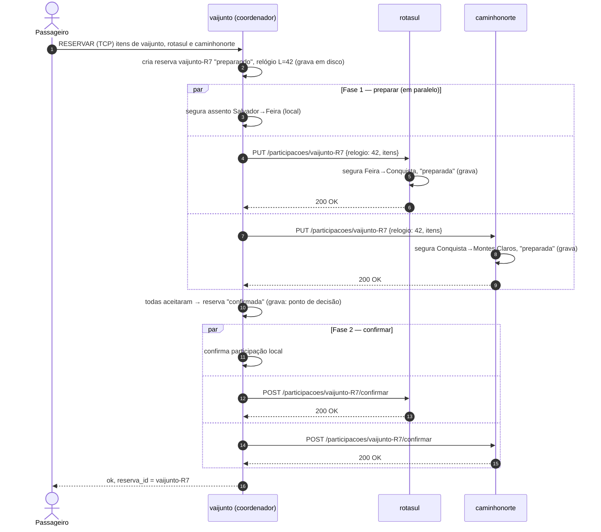

# API REST entre os servidores do consórcio

Cada empresa oferece esta API às demais na sua porta HTTP (padrão `9090`). Os
clientes motorista e passageiro **não** usam esta API — eles falam só com o
servidor da própria empresa, pelo protocolo TCP descrito em
[`protocolo.md`](protocolo.md).

Implementada com a biblioteca padrão do Go (`net/http`). Os mecanismos de
coordenação (reserva atômica, precedência e recuperação de falhas) são
implementados no próprio servidor, sem serviços de coordenação externos.

## Convenções

- Corpo das requisições e respostas em **JSON** (`Content-Type: application/json`).
- Todo erro tem o corpo `{"erro": "mensagem legível"}`.
- **Relógio de Lamport**: toda requisição e toda resposta entre servidores
  levam o cabeçalho `X-Relogio-Lamport: <valor>`. Ao receber, o servidor faz
  `relógio = max(relógio, recebido) + 1`; ao enviar, `relógio = relógio + 1`.
- **Timeout**: toda requisição a outra empresa espera no máximo **2 s**. Sem
  resposta nesse prazo (ou conexão recusada), a empresa é tratada como
  indisponível naquele momento — nunca como erro fatal.
- **Identificadores únicos no consórcio**:
  - carona: `"<empresa>-C<n>"` — ex.: `vaijunto-C3` (a empresa dona é o prefixo);
  - reserva: `"<empresa>-R<n>"` — ex.: `rotasul-R12` (a empresa coordenadora é o prefixo).
- **Idempotência**: todas as operações sobre `/participacoes/{id}` e
  `/reservas/{id}` podem ser repetidas sem efeito extra. Isso permite reenviar
  qualquer mensagem depois de um timeout ou de uma queda.

## Papéis numa reserva

- **Coordenador**: o servidor da empresa do passageiro. Guarda a reserva
  (`/reservas/{id}`) e decide se ela é confirmada ou abortada.
- **Participante**: cada empresa dona de algum trecho do itinerário. Guarda a
  sua **participação** (`/participacoes/{id}`): os assentos das suas caronas
  segurados ou confirmados para aquela reserva. Só o participante altera os
  assentos das suas caronas.

Uma mesma empresa pode ser coordenadora e participante da mesma reserva
(trechos dela mesma no itinerário); nesse caso ela age localmente, sem rede.

## Recursos

| Método e caminho | Papel | Uso |
|---|---|---|
| `GET /status` | qualquer | Identificação e verificação de vida (heartbeat) |
| `GET /caronas[?data=DD/MM/AAAA]` | qualquer | Caronas ativas da empresa, para a busca distribuída |
| `PUT /participacoes/{id}` | participante | **Fase 1**: segurar os assentos da reserva `{id}` |
| `POST /participacoes/{id}/confirmar` | participante | **Fase 2**: tornar definitiva |
| `POST /participacoes/{id}/abortar` | participante | **Fase 2**: desfazer e devolver os assentos |
| `POST /participacoes/{id}/cancelar` | participante | Cancelar uma participação confirmada |
| `GET /reservas/{id}` | coordenador | Informar a decisão sobre a reserva |
| `POST /reservas/{id}/preempcao` | coordenador | Pedido de reserva com precedência: abortar `{id}` se ainda não decidida |
| `POST /reservas/{id}/invalidacao` | coordenador | Uma carona da reserva foi cancelada pelo motorista |
| `GET /auditoria` | qualquer | Fotografia do estado (usada pelos testes) |

---

### `GET /status`

Resposta `200 OK`:
```json
{"empresa": "vaijunto", "status": "ativo"}
```
Usado periodicamente (a cada 5 s) por cada vizinho para detectar quedas, e
para descobrir qual empresa responde em cada endereço configurado.

### `GET /caronas`

Parâmetro opcional `data` (ex.: `?data=20%2F11%2F2026`) filtra pela data.

Resposta `200 OK`:
```json
{
  "empresa": "rotasul",
  "caronas": [
    {
      "id": "rotasul-C1",
      "rota": ["Feira de Santana", "Vitoria da Conquista"],
      "data": "20/11/2026",
      "preco_por_trecho": [60],
      "assentos_livres": [3]
    }
  ]
}
```
O nome do motorista não é enviado: a outra empresa não precisa dele para
montar itinerários (privacidade dos usuários). `assentos_livres` é uma foto
do momento; quem decide de fato se há assento é o participante, na fase 1.

### `PUT /participacoes/{id}` — fase 1 (preparar)

Corpo:
```json
{
  "coordenador": "vaijunto",
  "passageiro": "Maria",
  "relogio": 42,
  "itens": [
    {"empresa": "rotasul", "carona_id": "rotasul-C1", "trecho_inicio": 0, "trecho_fim": 0}
  ]
}
```
- `relogio` é o timestamp de Lamport da reserva, atribuído pelo coordenador
  quando ela foi criada. Junto com `coordenador`, define a precedência.
- Todos os itens precisam ser desta empresa.

Efeito: se houver assento em **todos** os trechos pedidos, eles são
segurados (deixam de aparecer como livres), a participação fica `preparada`
e é gravada em disco **antes** da resposta. Se faltar assento em qualquer
trecho, nada é segurado.

| Código | Quando | Corpo |
|---|---|---|
| `200 OK` | Assentos segurados (ou pedido repetido de uma participação já preparada/confirmada) | `{"reserva": "vaijunto-R7", "estado": "preparada", "itens": [...]}` com `origem`, `destino` e `preco` preenchidos |
| `400 Bad Request` | Corpo inválido, carona inexistente/inativa, intervalo de trechos inválido | `{"erro": "..."}` |
| `409 Conflict` | Sem assento livre, ou a reserva já tinha sido abortada/cancelada nesta empresa (pedido atrasado) | `{"erro": "..."}` |

Precedência (ver seção própria): se faltar assento e o pedido tiver
precedência sobre reservas **ainda não confirmadas** que ocupam o trecho, o
participante pede aos coordenadores delas `POST /reservas/{id}/preempcao`
antes de responder.

### `POST /participacoes/{id}/confirmar` — fase 2

Sem corpo. Torna a participação `confirmada`.

| Código | Quando |
|---|---|
| `200 OK` | Confirmada (ou já estava) — `{"reserva": "...", "estado": "confirmada"}` |
| `404 Not Found` | Participação desconhecida |
| `409 Conflict` | A participação já tinha sido abortada/cancelada |

### `POST /participacoes/{id}/abortar` — fase 2

Sem corpo. Devolve os assentos segurados e marca a participação `abortada`.
Se a participação ainda não existir (o pedido de preparação se perdeu ou
ainda vai chegar atrasado), ela é registrada como `abortada`, e uma
preparação que chegue depois é recusada com `409`.

| Código | Quando |
|---|---|
| `200 OK` | Abortada (ou já estava) |
| `409 Conflict` | A participação já estava confirmada |

### `POST /participacoes/{id}/cancelar`

Sem corpo. Devolve os assentos de uma participação confirmada (passageiro
cancelou a reserva, ou uma carona do itinerário foi cancelada). `200 OK`.

### `GET /reservas/{id}` — decisão do coordenador

Usado pelo participante quando o prazo de uma participação `preparada`
vence sem que a decisão tenha chegado.

| Código | Corpo |
|---|---|
| `200 OK` | `{"reserva": "vaijunto-R7", "estado": "preparando" \| "confirmada" \| "abortada" \| "cancelada"}` |
| `404 Not Found` | Reserva desconhecida → tratada como **abortada** (o coordenador grava a reserva antes de enviar qualquer preparação, então se ele não a conhece, ela nunca existiu) |

### `POST /reservas/{id}/preempcao`

Sem corpo. Enviado por um participante, em nome de uma reserva com
precedência, para que esta reserva ceda o assento. Se a reserva ainda estiver
`preparando`, o coordenador a **aborta** (e avisa todos os participantes);
se já foi confirmada, nada muda.

| Código | Corpo |
|---|---|
| `200 OK` | `{"reserva": "...", "estado": "abortada"}` (cedeu) ou `"confirmada"` (não cede mais) |
| `404 Not Found` | Reserva desconhecida (nunca existiu; o assento pode ser liberado) |

### `POST /reservas/{id}/invalidacao`

Sem corpo. Enviado pela empresa de uma carona cancelada pelo motorista. Se a
reserva estiver `preparando`, é abortada; se estiver `confirmada`, é
cancelada — em todas as empresas do itinerário. `200 OK` ou `404`.

### `GET /auditoria`

Fotografia completa do estado da empresa (caronas com assentos totais e
livres, reservas coordenadas, participações e número de mensagens ainda não
entregues). Usada pelo teste automatizado para verificar os invariantes.

---

## Confirmação de um itinerário com trechos de empresas diferentes

Passageiro da **vaijunto** reservando Salvador → Feira (vaijunto) → Conquista
(rotasul) → Montes Claros (caminhonorte). É um *two-phase commit*
implementado no próprio servidor, com o servidor do passageiro como
coordenador daquela reserva (não há coordenador fixo: cada empresa coordena
as reservas dos seus passageiros).



Se **qualquer** participante responder `409`/`400` ou não responder em 2 s
na fase 1, o coordenador grava a reserva como `abortada` e envia
`POST /participacoes/{id}/abortar` a **todos** os participantes (inclusive os
que aceitaram), que devolvem os assentos. O passageiro recebe a recusa com o
motivo.

O ponto de decisão é a gravação da reserva `confirmada`/`abortada` no
coordenador. A partir dela, as mensagens da fase 2 ficam pendentes (registradas
na própria reserva, no mesmo arquivo da decisão) e são **reenviadas a cada
1 s** até cada empresa responder — mesmo que o coordenador ou o participante
caiam no meio.

## Precedência na disputa pelo último assento

Requisito: com relógios não sincronizados e mensagens que atrasam, definir
quem fica com o último assento quando duas reservas o disputam a partir de
servidores diferentes.

**Critério**: cada reserva recebe, ao ser criada no coordenador, um
**timestamp de Lamport** `L`. A reserva `(L₁, empresa₁)` tem precedência
sobre `(L₂, empresa₂)` se `L₁ < L₂`, ou `L₁ = L₂` e `empresa₁ < empresa₂`
(ordem alfabética do ID). É uma ordem total, igual em todas as empresas, que
não depende de relógio físico.

**Aplicação** (no participante dono do assento, que é a única autoridade
sobre ele):

1. Assento livre → quem chega primeiro segura.
2. Assento segurado por uma reserva **ainda não confirmada** e chega uma
   reserva **com precedência** → o participante pede ao coordenador da
   reserva mais nova `POST /reservas/{id}/preempcao`. Se ela ainda não foi
   decidida, é abortada e o assento passa para a mais antiga.
3. Chega uma reserva **sem precedência** → recebe `409` imediatamente. Ela
   **não espera** pelo assento, o que impede deadlock entre reservas que
   disputam assentos em empresas diferentes em ordens diferentes.
4. Assento **confirmado** nunca é tomado.

```mermaid
sequenceDiagram
    participant G as gama (coordena r2, L=10)
    participant B as beta (dona do último assento)
    participant A as alfa (coordena r1, L=7)

    G->>B: PUT /participacoes/gama-R2 {relogio: 10}
    B-->>G: 200 OK (segura o último assento)
    Note over A,B: a mensagem de alfa atrasou na rede
    A->>B: PUT /participacoes/alfa-R1 {relogio: 7}
    Note over B: sem assento; 7 < 10 → alfa-R1 tem precedência
    B->>G: POST /reservas/gama-R2/preempcao
    G->>G: gama-R2 ainda "preparando" → abortada
    G-->>B: 200 {"estado": "abortada"}
    B->>B: devolve o assento de gama-R2 e segura para alfa-R1
    B-->>A: 200 OK
```

## Falhas e recuperação

Cada empresa grava cada alteração num arquivo próprio **antes de responder**
(escrita em arquivo temporário + renomear, que é atômico). Os assentos livres
não são gravados: ao reiniciar, são recalculados a partir das participações
`preparadas`/`confirmadas`. Assim uma queda no meio de uma gravação nunca
deixa assento ocupado sem reserva, nem reserva sem assento.

| Situação | O que acontece |
|---|---|
| Participante não responde na fase 1 | Coordenador aborta a reserva (timeout de 2 s) e avisa os demais |
| Coordenador cai antes de decidir | Participantes mantêm o assento segurado até o **prazo de decisão** (padrão 10 s); depois perguntam `GET /reservas/{id}`. Enquanto o coordenador estiver fora do ar, esperam e perguntam de novo. Ao voltar, o coordenador **aborta toda reserva que estava `preparando`** e avisa os participantes, que liberam os assentos |
| Coordenador cai depois de decidir | A decisão já está gravada; ao voltar, ele reenvia as mensagens pendentes. Os participantes também podem perguntar a decisão |
| Participante cai depois de preparar | Ao voltar, recarrega a participação `preparada` (assento continua segurado) e recebe a decisão pelo reenvio do coordenador, ou pergunta quando o prazo vence |
| Mensagem de preparação chega depois do aborto | O aborto deixou registro; a preparação atrasada recebe `409` |
| Vizinho fora do ar durante uma busca | Ignorado; a busca segue com as caronas das empresas disponíveis |

Limitação conhecida (inerente ao *two-phase commit*): se o coordenador cair
exatamente depois de todos os participantes aceitarem e antes de gravar a
decisão, os assentos ficam segurados até ele voltar — o participante não pode
decidir sozinho sem arriscar um itinerário pela metade. A escolha foi por
**consistência** em vez de disponibilidade para essas poucas reservas
(teorema CAP); todas as outras caronas e empresas continuam operando
normalmente.
